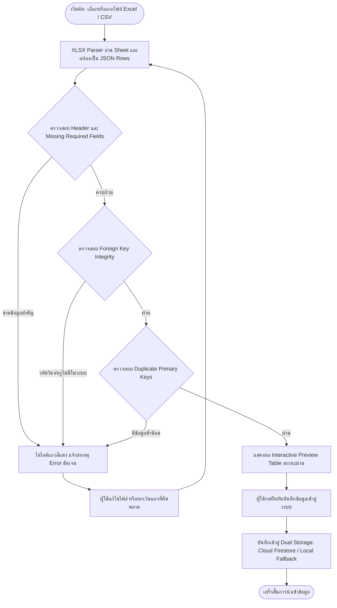
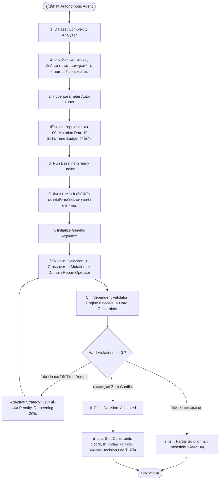
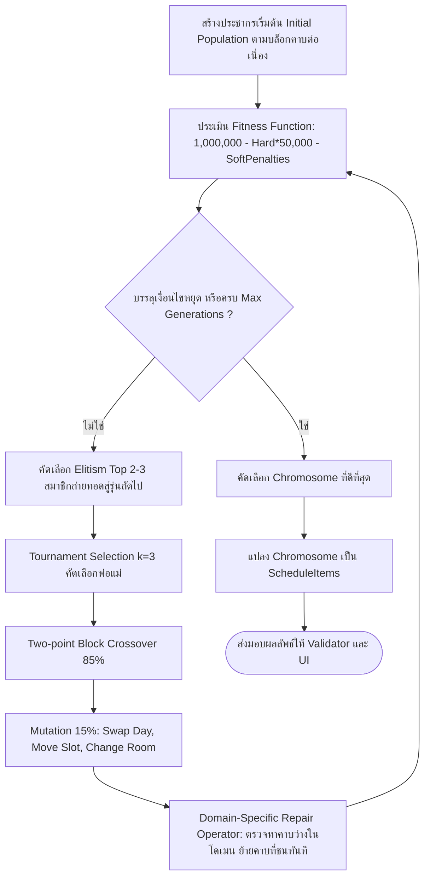
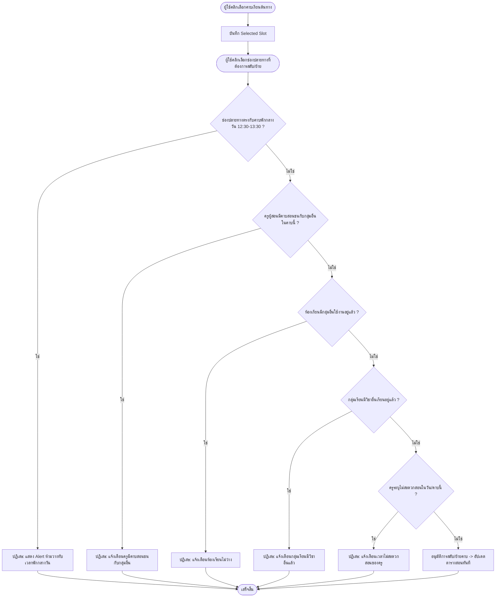

# 🔄 ผังงานการทำงานของระบบ (FLOWCHART.md)
## ระบบจัดตารางการเรียนการสอนอัตโนมัติ: Learning-Time

เอกสารนี้แสดงผังงาน Flowcharts ครอบคลุม 4 โมดูลหลักของระบบตามเกณฑ์การประเมินทักษะ AI (ระดับ ปวส. ภาค):

---

## 1. ผังงานกระบวนการนำเข้าและตรวจสอบข้อมูล (Data Import & Validation Flow)

---

## 2. ผังงานกระบวนการทำงานของ Autonomous Scheduling Agent

---

## 3. ผังงานการทำงานของ Genetic Algorithm (GA Engine with Repair)

---

## 4. ผังงานการตรวจสอบคาบเรียนแบบ Real-time เมื่อผู้ใช้ลากสลับคาบ (Live Placement Check)

